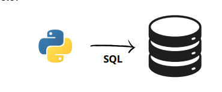

# 🗄️ Módulo 05: Banco de Dados e SQL

## Conceitos Fundamentais
* **banco de dados:** é organizado para armazenar dados de forma estruturada e eficiente, facilitando consultas e manutenção.
* **SGBD:** Software que gerencia e protege os dados (ex: PostgreSQL, MySQL, SQLite).
* **Estrutura:** Banco de Dados, Tabelas, Colunas (atributos) e Linhas (registros).
* **Chave Primária (PK):** Identificador único de cada linha na tabela (ex: `id`).
* **Relacionamentos Entre Tabelas:** `1:1` (Um para Um), `1:N` (Um para Muitos) e `N:N` (Muitos para Muitos, usando tabela associativa).

---

## Propriedades ACID (Transações)
Garantem que uma transação (sequência indivisível de operações) seja confiável:

1. **Atomicity (Atomicidade):** Princípio do "tudo ou nada". Se uma etapa falhar, tudo é desfeito (*rollback*).
2. **Consistency (Consistência):** O banco só passa de um estado válido para outro, respeitando chaves e regras.
3. **Isolation (Isolamento):** Impede que transações simultâneas interfiram umas nas outras (evitando *Dirty Read*, *Non-repeatable Read* e *Phantom Read*).
4. **Durability (Durabilidade):** Após confirmados (*commit*), os dados permanecem salvos mesmo se houver queda de energia (via *WAL - Write-Ahead Logging*).

---

## Comandos Essenciais SQL (SQLite)
* SQLite é um banco de dados leve, que armazena os dados em um único arquivo, ideal paraaplicações pequenas e testes. Ele suporta comandos SQL padrão para criação, inserção e consulta de dados.

### Criar, Correlacionar e Apagar Tabelas
```sql
CREATE TABLE IF NOT EXISTS autores (
    id INTEGER PRIMARY KEY AUTOINCREMENT,
    nome TEXT NOT NULL,
    email TEXT UNIQUE
);

CREATE TABLE IF NOT EXISTS books (
    id INTEGER PRIMARY KEY AUTOINCREMENT,
    title TEXT NOT NULL,
    author_id INTER NOT NULL
    FOREIGH KEY (author_id) REFERENCES authors(id)
    )

DROP TABLE autores;
```

### CRUD (Inserir, Consultar, Atualizar e Deletar)
```sql
-- 1. INSERIR DADOS
INSERT INTO autores (nome, email) VALUES ('Caio', 'email@gmail.com');

-- 2. CONSULTAR DADOS
SELECT * FROM autores;
SELECT nome FROM autores WHERE nome LIKE '%Caio%';

-- 3. ATUALIZAR DADOS
UPDATE autores
SET nome = 'Caio Silva'
WHERE id = 1;

-- 4. DELETAR DADOS (Sempre use WHERE para não apagar a tabela inteira!)
DELETE FROM autores WHERE id = 1;
```

---

## Integração com Python
* Ao desenvolver aplicações que interagem com bancos de dados relacionais, é comum se deparar com duas abordagens principais:
escrever SQL direto (SQL puro) ou utilizar um ORM (Object-Relational Mapping).

### SQL Direto:
* **SQL Direto:** O Python envia comandos SQL puros através de um driver/conector (como o módulo nativo `sqlite3`).



* No SQL direto, o desenvolvedor escreve manualmente as queries para inserir, consultar, atualizar e deletar dados.

### ORM:
* **ORM (*Object-Relational Mapping*):** Ferramentas (como *SQLAlchemy* ou *Django ORM*) que permitem manipular tabelas do banco usando classes e objetos Python em vez de escrever SQL manual.


**Comparação Direta:**

|    Aspecto    |             SQL direto              |                     ORM                         |
| :------------ | :---------------------------------- | :-----------------------------------------------|
| Controle      | total sobre as queries              | abstraido pelo framework                        |
| Performace    | potencialmente superior             | pode ser menor em consultas complexas           |
| Produtividade | menor (mais codigo repetido)        | maior (menos codigo, mais abstração)            |
| Manutenção    | dificil em projetos grandes         | mais facil, codigo centralizado                 |
| Portabilidade | baixa, dependente do SGBD           | alta, abstrai diferenças entre bancos           |
| Complexidade  | elevada em queries avançadas        | pode ser limitada para consultas especificas    |
| Segurança     | depende do cuidado do desenvolvedor | ORM ja implementa proteções basicas             |


### comandos — Conexão Python + Banco:
```python
import sqlite3

# criando um banco de dados e se conecta a ele:
conection = sqlite3.connect('name_date_base.db') 

# realizando as ações dentro do sqlite:
cursor = conection.cursor()

# executando os codigos SQL:
cursor.execute('''INSERT INTO autores (nome, email) VALUES ('Caio', 'email@gmail.com');''')

# exucute multiplos comandos:
cursor.executescript(f"INSERT INTO autores (nome, email) VALUES ('Caio', 'email@gmail.com'); INSERT INTO autores (nome, email) VALUES ('Davi', 'email@gmail.com');")

# fechando a conexão com o banco de dados:
conection.close()

# comitando o codigo:
conection.commit()

# fazendo rollback:
conection.rollback()

# metodo with protegido de SQL injection:
with sqlite3.connect('name_date_base.db') as conection:
    cursor = conection.cursor()
    cursor.execute("INSERT INTO authors (name) VALUES (?)", (name,))

# buscando dados:
with sqlite3.connect('name_date_base.db') as conection:
    cursor = conection.cursor()
    cursor.execute("SELECT * FROM authors")
    authors = cursor.fetchall()
    print(authors) 
```
>**pools limitadas:** o banco de dados possiu um limite de conexões, então lembre de fechalas com `close`.
>**Cuidado com SQL INJECTION:** ao deixar o usuario adicionar dados no banco de dados ele pode tentar usar comandos para alterar sua tabela, para evitar use o comando `exucute` em vez do `executescript`
